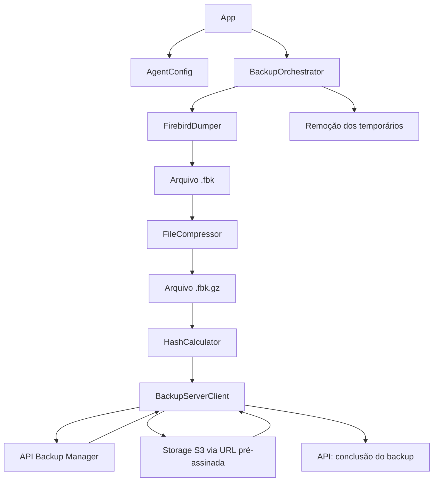
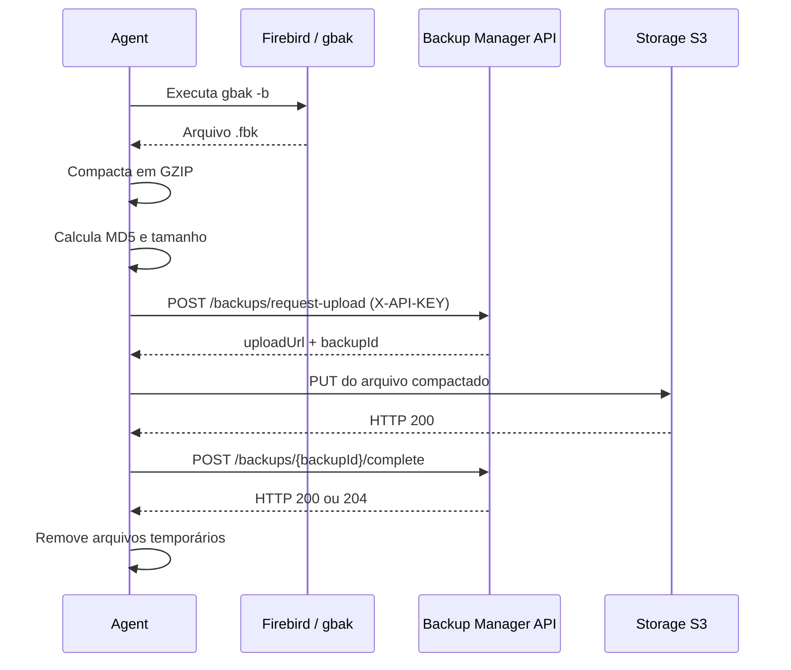

# Backup Manager — Agent

Agente responsável por executar o backup de bancos de dados Firebird instalados nos ambientes dos mercados e enviar os arquivos para o Backup Manager. A aplicação é um processo Java independente: quando iniciada, executa uma rotina completa de backup, comunica-se com a API central e encerra o processo ao terminar.

O agente utiliza o utilitário nativo `gbak` para gerar o dump do Firebird, compacta o arquivo em GZIP, calcula seu hash MD5 e solicita à API uma URL pré-assinada. O arquivo compactado é enviado diretamente ao storage compatível com S3, sem passar pelo servidor da aplicação. Ao final, o agente informa à API se a operação foi concluída ou falhou.

---

## Sumário

- [Visão geral](#visão-geral)
- [Principais responsabilidades](#principais-responsabilidades)
- [Tecnologias e requisitos](#tecnologias-e-requisitos)
- [Arquitetura e organização](#arquitetura-e-organização)
- [Fluxo de execução](#fluxo-de-execução)
- [Integração com a API](#integração-com-a-api)
- [Configuração](#configuração)
- [Compilação e execução](#compilação-e-execução)
- [Arquivos temporários e logs](#arquivos-temporários-e-logs)
- [Execução recorrente](#execução-recorrente)
- [Tratamento de falhas](#tratamento-de-falhas)
- [Segurança e operação](#segurança-e-operação)

---

## Visão geral

O agente é instalado ou executado no ambiente que possui acesso ao banco Firebird do mercado. Ele não mantém uma conexão JDBC com o banco e não implementa o protocolo de backup do Firebird por conta própria: a geração do arquivo é delegada ao executável `gbak`, distribuído com as ferramentas do Firebird.

O agente é responsável por coordenar as etapas locais e remotas do processo:

1. Ler as configurações do mercado e da API central.
2. Executar o `gbak` para gerar um arquivo `.fbk`.
3. Compactar o dump em GZIP, gerando um arquivo `.fbk.gz`.
4. Calcular o MD5 e o tamanho do arquivo compactado.
5. Solicitar à API autorização e uma URL pré-assinada de upload.
6. Enviar o arquivo diretamente ao storage.
7. Comunicar à API o resultado final do backup.
8. Remover os arquivos temporários locais.

Cada execução realiza uma tentativa de backup. O processo não permanece em execução como serviço HTTP e não contém um agendador interno.

## Principais responsabilidades

- Executar backups de bancos Firebird utilizando `gbak`.
- Configurar host, porta, caminho do banco e credenciais de acesso ao Firebird.
- Compactar os arquivos gerados com GZIP.
- Calcular o hash MD5 do arquivo que será enviado.
- Solicitar à API central uma autorização de upload usando a API Key do mercado.
- Enviar o arquivo por HTTP PUT diretamente para uma URL pré-assinada.
- Informar à API central o status final da execução.
- Registrar eventos e falhas em log de console e arquivo.
- Remover os arquivos temporários após a execução.

---

## Tecnologias e requisitos

| Tecnologia / ferramenta | Uso |
|---|---|
| Java 21 | Linguagem e runtime do agente |
| Maven | Compilação, empacotamento e gerenciamento de dependências |
| Firebird `gbak` | Geração nativa do backup do banco Firebird |
| Java `HttpClient` | Comunicação HTTP com a API e upload para o storage |
| Jackson | Serialização e desserialização de JSON |
| GZIP (`GZIPOutputStream`) | Compactação do arquivo de backup |
| MD5 (`MessageDigest`) | Cálculo do hash do arquivo compactado |
| SLF4J / Logback | Logging em console e arquivo |
| JUnit 5 | Infraestrutura de testes |

### Requisitos de ambiente

- JDK 21 para compilar e executar o agente.
- Maven instalado para compilar o projeto (o pacote atual não inclui Maven Wrapper).
- Executável `gbak` instalado e disponível no `PATH` do usuário que executará o agente.
- Acesso de rede ao servidor Firebird configurado.
- Acesso HTTP à API central do Backup Manager.
- Acesso de saída ao endereço da URL pré-assinada retornada pela API, para envio do arquivo ao storage.
- Permissão de leitura no banco Firebird e permissão de escrita no diretório temporário configurado.

> **Importante:** instalar o servidor Firebird não garante, por si só, que o comando `gbak` esteja disponível no terminal. Verifique a instalação das ferramentas cliente e o `PATH` do usuário que executará o agente.

---

## Arquitetura e organização

O agente utiliza uma arquitetura pequena e orientada à responsabilidade de cada componente. A classe `BackupOrchestrator` coordena o processo, enquanto as classes especializadas executam as operações locais e a comunicação com a API.

```text
src/main/java/com/microservice/backupagent/
│
├── App.java                         # Ponto de entrada da aplicação
│
├── config/
│   └── AgentConfig.java             # Leitura e validação das configurações
│
├── orchestrator/
│   └── BackupOrchestrator.java      # Coordenação do fluxo de backup
│
├── dumper/
│   └── FirebirdDumper.java          # Execução do utilitário gbak
│
├── compressor/
│   └── FileCompressor.java          # Compactação GZIP
│
├── hasher/
│   └── HashCalculator.java          # Cálculo do hash MD5
│
├── client/
│   └── BackupServerClient.java      # Comunicação com API e storage
│
└── dto/
    ├── CreateUploadRequest.java     # Dados enviados para solicitar upload
    ├── BackupUploadResponse.java    # URL de upload e identificador do backup
    └── CompleteBackupRequest.java  # Resultado final comunicado à API
```

### Responsabilidades dos componentes

| Componente | Responsabilidade |
|---|---|
| `App` | Inicializa os componentes, carrega a configuração, executa o orquestrador e encerra o processo com código de saída apropriado. |
| `AgentConfig` | Lê o arquivo `agent.properties`, aplica valores padrão e verifica as propriedades obrigatórias. |
| `FirebirdDumper` | Monta o endereço do banco e executa o processo externo `gbak`. |
| `FileCompressor` | Lê o dump e gera uma versão compactada com GZIP. |
| `HashCalculator` | Calcula o MD5 do arquivo compactado em blocos de leitura. |
| `BackupServerClient` | Solicita autorização à API, faz upload ao storage e comunica a conclusão. |
| `BackupOrchestrator` | Coordena as etapas, trata falhas e remove os arquivos temporários. |

### Fluxo entre os componentes



---

## Fluxo de execução



### Etapas em detalhe

1. **Leitura da configuração:** `AgentConfig` carrega a URL da API, API Key, conexão Firebird e diretório temporário.
2. **Geração do dump:** `FirebirdDumper` executa `gbak` com a opção `-b` (backup), credenciais configuradas, origem Firebird e destino local. O nome do arquivo segue o padrão `backup_yyyyMMdd_HHmmss.fbk`.
3. **Compactação:** `FileCompressor` gera um arquivo `.gz` ao lado do dump. O resultado segue o padrão `backup_yyyyMMdd_HHmmss.fbk.gz`.
4. **Integridade e metadados:** `HashCalculator` calcula o MD5 do arquivo compactado. O agente também obtém seu tamanho em bytes.
5. **Autorização de upload:** o agente envia o nome e tamanho do arquivo para a API. O servidor cria o registro de backup e devolve um identificador e uma URL pré-assinada.
6. **Upload:** o agente envia o arquivo compactado diretamente para o storage, por HTTP PUT.
7. **Conclusão:** após o upload bem-sucedido, o agente comunica `SUCCESS`, o MD5 e o identificador do backup à API.
8. **Limpeza:** ao final, o agente tenta apagar tanto o dump original quanto o arquivo compactado.

O cálculo de hash e tamanho acontece sobre o arquivo **compactado**, isto é, sobre o conteúdo efetivamente enviado ao storage.

---

## Integração com a API

O agente utiliza a API Key individual do mercado no header `X-API-KEY`. Essa chave identifica o mercado de origem e permite ao backend associar a execução ao estabelecimento correto.

### 1. Solicitar autorização de upload

```http
POST /api/v1/backups/request-upload
Content-Type: application/json
X-API-KEY: <API_KEY_DO_MERCADO>
```

Corpo enviado:

```json
{
  "fileName": "backup_20261031_030000.fbk.gz",
  "fileSizeBytes": 125829120
}
```

Resposta esperada (`200` ou `201`):

```json
{
  "uploadUrl": "https://storage.example.com/presigned-upload-url",
  "backupId": "00000000-0000-0000-0000-000000000000"
}
```

O agente utiliza o `backupId` para comunicar a conclusão e a `uploadUrl` para enviar o arquivo ao storage.

### 2. Enviar o arquivo ao storage

O upload é feito diretamente para a URL pré-assinada, sem enviar o conteúdo binário pela API central.

```http
PUT <UPLOAD_URL_RETORNADA_PELA_API>
```

O corpo da requisição é o próprio arquivo `.fbk.gz`. A implementação atual considera o upload bem-sucedido quando o storage responde com HTTP `200`.

### 3. Comunicar a conclusão

```http
POST /api/v1/backups/{backupId}/complete
Content-Type: application/json
X-API-KEY: <API_KEY_DO_MERCADO>
```

Exemplo de conclusão bem-sucedida:

```json
{
  "status": "SUCCESS",
  "fileHashMd5": "0123456789abcdef0123456789abcdef",
  "errorMessage": null
}
```

Exemplo de falha após a API já ter criado o registro do backup:

```json
{
  "status": "FAILED",
  "fileHashMd5": null,
  "errorMessage": "Falha ao enviar o arquivo ao storage."
}
```

A implementação aceita HTTP `200` ou `204` como confirmação da conclusão.

### Timeouts HTTP

| Operação | Timeout configurado |
|---|---:|
| Solicitação de autorização de upload | 30 segundos |
| Upload do arquivo ao storage | 30 minutos |
| Comunicação da conclusão | 30 segundos |

O cliente HTTP segue redirecionamentos normais. Não existe, na implementação atual, uma política explícita de retry com backoff para requisições que falharem.

---

## Configuração

O agente utiliza um arquivo externo chamado `agent.properties`.

### Exemplo de configuração

Crie um arquivo `agent.properties` com os valores adequados ao ambiente do mercado:

```properties
# API central do Backup Manager (não adicionar /api/v1)
server.url=http://localhost:8080
server.api-key=SUBSTITUA_PELA_API_KEY_DO_MERCADO

# Conexão com o Firebird
db.host=127.0.0.1
db.port=3050
db.path=/caminho/absoluto/para/market.fdb
db.user=SYSDBA
db.password=SUBSTITUA_PELA_SENHA_DO_FIREBIRD

# Diretório para dumps e arquivos compactados temporários
backup.temp-dir=/var/lib/backup-manager/temp
```

### Propriedades disponíveis

| Propriedade | Obrigatória | Valor padrão no código | Descrição |
|---|:---:|---|---|
| `server.url` | Sim | — | URL base da API central, por exemplo `http://localhost:8080`. |
| `server.api-key` | Sim | — | API Key do mercado cadastrado no Backup Manager. |
| `db.host` | Não | `localhost` | Host ou endereço do servidor Firebird. |
| `db.port` | Não | `3050` | Porta do serviço Firebird. |
| `db.path` | Sim | — | Caminho do arquivo de banco Firebird no ambiente em que o serviço Firebird consegue acessá-lo. |
| `db.user` | Não | `SYSDBA` | Usuário utilizado pelo `gbak`. |
| `db.password` | Não | `masterkey` | Senha do usuário Firebird. Configure explicitamente uma senha segura no ambiente real. |
| `backup.temp-dir` | Não | `/tmp/backups` | Diretório local usado para gerar os arquivos temporários. |

### Como o caminho do arquivo de configuração é resolvido

O caminho pode ser informado como argumento na inicialização:

- Se o argumento apontar para um **arquivo**, o agente utiliza esse arquivo.
- Se o argumento apontar para um **diretório**, o agente procura `agent.properties` dentro dele.
- Se nenhum argumento for informado, o agente procura `agent.properties` no diretório de trabalho atual do processo.

Exemplos:

```bash
# Procura ./agent.properties no diretório atual
java -jar target/backupmanager-agent-1.0-SNAPSHOT.jar

# Utiliza um arquivo específico
java -jar target/backupmanager-agent-1.0-SNAPSHOT.jar /etc/backup-manager/agent.properties

# Procura /etc/backup-manager/agent.properties
java -jar target/backupmanager-agent-1.0-SNAPSHOT.jar /etc/backup-manager
```

> **Atenção à configuração externa:** embora exista um `agent.properties` em `src/main/resources` no projeto, a implementação atual de `AgentConfig` procura um arquivo no sistema de arquivos (`FileInputStream`), e não carrega automaticamente o recurso de dentro do JAR. Ao distribuir o agente, disponibilize o arquivo externo e informe seu caminho ou execute o processo a partir do diretório onde ele está.

### Cuidados com a configuração

- Não versione API Keys ou senhas reais no Git.
- Restrinja as permissões de leitura do `agent.properties` ao usuário responsável pela execução do agente.
- Evite compartilhar logs ou arquivos de configuração que contenham informações sensíveis.
- Utilize caminhos absolutos para `db.path` e `backup.temp-dir` para evitar ambiguidades de diretório.
- Garanta que `server.url` não termine com `/`, pois os caminhos da API são concatenados diretamente a essa propriedade.
- O `db.path` precisa ser válido para o servidor Firebird alcançado por `db.host` e `db.port`; não é necessariamente um caminho acessível diretamente pelo processo Java do agente.
- A API Key deve pertencer ao mercado correto e estar ativa no backend.

---

## Compilação e execução

### 1. Verificar Java e Maven

```bash
java -version
mvn -version
```

Utilize Java 21. O projeto não inclui `mvnw`, portanto os comandos abaixo pressupõem que Maven esteja instalado e disponível no `PATH`.

### 2. Compilar e empacotar

Na raiz do projeto:

```bash
mvn clean package
```

O Maven gera o JAR executável em:

```text
target/backupmanager-agent-1.0-SNAPSHOT.jar
```

O empacotamento utiliza o Maven Shade Plugin para incluir as dependências e configurar `com.microservice.backupagent.App` como classe principal do JAR.

### 3. Preparar a configuração

Crie o arquivo externo `agent.properties`, conforme a seção [Configuração](#configuração). Confirme que o usuário que executará o agente consegue ler esse arquivo e gravar no diretório indicado por `backup.temp-dir`.

### 4. Executar

```bash
java -jar target/backupmanager-agent-1.0-SNAPSHOT.jar /caminho/para/agent.properties
```

Sem argumento, o agente procura `agent.properties` no diretório de trabalho atual:

```bash
java -jar target/backupmanager-agent-1.0-SNAPSHOT.jar
```

A aplicação executa uma tentativa de backup e encerra o processo. O código de saída é `0` em caso de sucesso e `1` quando ocorre uma falha fatal.

---

## Arquivos temporários e logs

### Arquivos de backup

Durante a execução, o agente cria dois arquivos no diretório `backup.temp-dir`:

1. Dump Firebird: `backup_yyyyMMdd_HHmmss.fbk`.
2. Arquivo compactado: `backup_yyyyMMdd_HHmmss.fbk.gz`.

O orquestrador tenta remover ambos no bloco `finally`, tanto em caso de sucesso quanto de falha. Se a remoção não for possível, a ocorrência é registrada no log e o arquivo pode permanecer no diretório temporário; por isso, é recomendável monitorar o espaço disponível.

### Logs

O Logback registra mensagens em console e em arquivo, com nível padrão `INFO`.

Ao iniciar a aplicação empacotada, `App` define `LOG_DIR` como uma pasta `logs` localizada ao lado do JAR. O arquivo principal é:

```text
logs/agent.log
```

A política de rotação é diária e mantém até 30 períodos de histórico configurados no Logback.

Os logs registram etapas do processo, tempos de resposta, nomes de arquivos, identificadores de backup e detalhes de falhas. Não compartilhe logs externamente sem revisar seu conteúdo.

---

## Execução recorrente

O agente atual é um processo de execução única: ele realiza um backup e encerra. Não há scheduler interno, daemon ou serviço permanente implementado no código.

Para executar backups periodicamente, configure um agendador externo no ambiente do mercado, por exemplo:

- `cron` ou `systemd timer` em Linux;
- Agendador de Tarefas do Windows, em ambientes Windows compatíveis com a instalação do Firebird e do Java.

O agendador deve executar o JAR com o arquivo `agent.properties` correto e com um usuário que tenha acesso ao `gbak`, ao banco Firebird, ao diretório temporário e à rede.

Evite iniciar duas execuções simultâneas para o mesmo mercado sem antes definir uma política de concorrência. A implementação atual não possui mecanismo próprio de lock para impedir execuções sobrepostas.

---

## Tratamento de falhas

O `BackupOrchestrator` coordena a recuperação possível dentro de uma execução:

- Se a geração do dump falhar, a execução é interrompida.
- Se a compactação ou o cálculo do hash falhar, a execução é interrompida.
- Se a solicitação de upload falhar antes de a API retornar um `backupId`, o agente não tem um identificador com o qual comunicar a falha.
- Se ocorrer uma falha depois de receber o `backupId`, o agente tenta comunicar `FAILED` à API, incluindo a mensagem da exceção.
- Se a própria comunicação de falha também falhar, a ocorrência é registrada em log.
- Em qualquer cenário, o agente tenta remover os arquivos temporários.

O fluxo não implementa fila local, retomada de upload, retry automático com backoff ou persistência local de operações pendentes. Se o processo for interrompido ou a rede ficar indisponível, a análise deve considerar os logs do agente e o estado registrado pela API central.

---

## Segurança e operação

- **Credenciais Firebird:** utilize um usuário com permissões adequadas para realizar o backup e evite manter credenciais padrão em ambientes reais.
- **API Key:** cada agente deve utilizar a chave do mercado correspondente. Não reutilize a mesma chave entre mercados.
- **Tráfego de rede:** em produção, utilize HTTPS para comunicação com a API. A URL pré-assinada deve ser acessível pelo agente e válida durante o upload.
- **Storage:** o agente não recebe credenciais permanentes do S3. Ele utiliza a URL pré-assinada concedida pela API para realizar o PUT.
- **Diretório temporário:** restrinja permissões e monitore o espaço em disco, pois os arquivos de banco podem ser grandes.
- **Logs:** proteja os arquivos de log e limite o acesso a operadores autorizados.
- **Agendamento:** execute o processo com uma conta de serviço dedicada e com permissões mínimas necessárias.

O hash MD5 é utilizado para identificar/verificar a integridade do arquivo no fluxo atual. MD5 não deve ser considerado um mecanismo moderno de autenticação ou proteção contra adulteração maliciosa.

---
